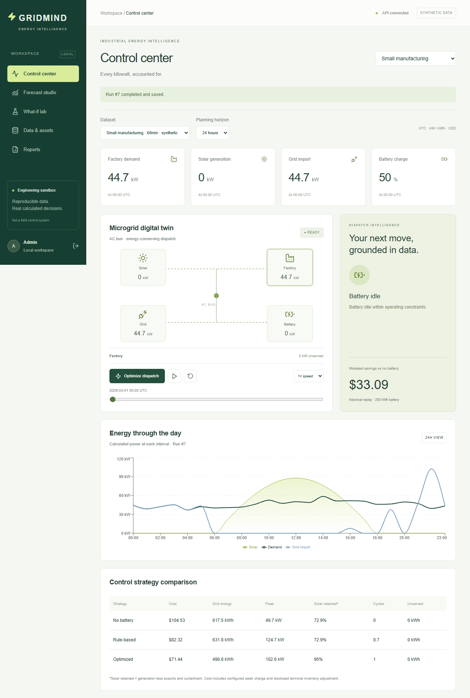

# GRIDMIND

**Industrial Energy Intelligence and Microgrid Digital Twin**

A local energy engineering application that connects factory demand, rooftop solar, battery storage and time-of-use tariffs. Forecasts, dispatch schedules, savings and outage results come from backend calculations. No paid APIs or external hardware are required.



## Run locally

Install Docker Desktop with the Linux engine running, then:

```sh
git clone https://github.com/jeelthacker1/gridmind.git
cd gridmind
docker compose up --build
```

Open **http://localhost:3000**. Get the first-run generated password:

```sh
docker compose logs api
```

Sign in with `admin@gridmind.local`, `analyst@gridmind.local`, or `viewer@gridmind.local`. All three demo accounts initially share the generated password. Optionally copy `.env.example` to `.env` and set `DEMO_PASSWORD` **before the first start**. Existing users are not overwritten on restart. Database and job state persist in Docker volumes.

The default stack binds only to loopback. It is a local engineering demo, not an approved electrical controller. Before network deployment, provision unique credentials, HTTPS, secure cookies, appropriate origin restrictions and operational monitoring. The example database password is a local-only default, not a production secret.

## What works

- Three reproducible factory profiles, each with hourly and 15-minute datasets, weather-dependent solar and shift-based demand components.
- Validated CSV imports, timezone normalization, explicit W/kW/MW conversion, missing-value rejection, opt-in outlier clipping and immutable dataset versions.
- Seasonal-naive and gradient-boosting forecasts, chronological train/validation/test splits, recursive multi-step prediction, 24-hour/7-day horizons and measured accuracy.
- SciPy/HiGHS mixed-integer battery dispatch with power limits, efficiency, reserve, terminal SOC, optional horizon peak charge and mutually exclusive charge/discharge and grid import/export.
- No-battery, rule-based and optimized comparisons with computed costs, imports, peaks, throughput, cycles, retained solar, carbon estimates and unserved energy.
- Live control center with server-owned simulation clock, start/pause/resume/reset, speed control, historical seeking and SSE updates.
- Eight what-if scenarios including tariffs, solar, storage, efficiency, production, night shifts and outages. Critical load is prioritized during islanded operation.
- Cookie authentication, admin/analyst/viewer roles, origin checks, login rate limits, audit logs and password hashing.
- Saved runs, dataset CSV exports and stored-result CSV/PDF performance, forecast and scenario reports.
- PostgreSQL, Alembic, Redis/RQ worker, health checks, pytest, Playwright and GitHub Actions.

## A five-minute walkthrough

1. Sign in and select **Small manufacturing**.
2. Click **Optimize dispatch**. Inspect the three control strategies and computed savings.
3. Start the simulation, change its speed, pause and inspect a historical interval.
4. Open **Forecast studio**, generate a forecast and inspect held-out MAE/RMSE/sMAPE.
5. Check **Use forecast** to optimize future predicted demand and repeated-week solar.
6. Open **What-if lab**, run **Tariff +25%**, then **Grid outage**. Compare cost and unserved energy.
7. Edit and save an asset configuration in **Data & assets**; download or import a dataset.
8. Open **Reports**, inspect a stored run and export CSV/PDF.

## Stack

| Layer | Implementation |
|---|---|
| Interface | Next.js App Router, strict TypeScript, Tailwind, shadcn-style Radix Button, Recharts, Zustand |
| API | FastAPI, Pydantic, SQLAlchemy, Alembic |
| Engineering | NumPy, Pandas, scikit-learn, SciPy/HiGHS |
| Persistence | PostgreSQL in Compose; SQLite supported for development/tests |
| Jobs / live state | Redis/RQ, persistent simulation state, server-sent events |
| Verification | pytest, Playwright, GitHub Actions, Compose health checks |

## Developer setup without Docker

Python 3.13 and Node.js 22+ are supported.

```sh
python -m venv .venv
# Activate .venv (Windows: .venv\Scripts\Activate.ps1)
source .venv/bin/activate
pip install -r backend/requirements.txt
cd backend
alembic upgrade head
python -m app.seed
# Set JOB_MODE=inline for synchronous local jobs; production Compose uses Redis.
JOB_MODE=inline uvicorn app.main:app --host 127.0.0.1 --port 8000
```

On PowerShell, use `$env:JOB_MODE='inline'` before `python -m uvicorn app.main:app --host 127.0.0.1 --port 8000`. In another terminal:

```sh
cd frontend
npm ci
npm run dev
```

Use `http://localhost:3000` (the default allowed origin). API documentation: **http://localhost:8000/docs**. Set `APP_ORIGIN` to a comma-separated list when using a different browser origin. Set `API_URL` before the frontend build when changing the API address; rewrites are compiled into the build.

## Tests

```sh
cd backend
python -m pytest -q
python ../scripts/benchmark.py
cd ../frontend
npm ci
npm run build
npx playwright install chromium
# API + frontend must be running; set DEMO_PASSWORD to their demo password.
npm run test:e2e
```

CI additionally builds and starts the complete five-service Compose deployment. See [validation](docs/VALIDATION.md) for actual execution results and limits.

## Engineering documentation

- [Architecture and database schema](docs/ARCHITECTURE.md)
- [Optimization mathematics, units and physical assumptions](docs/MODEL.md)
- [Forecast methodology](docs/FORECASTING.md)
- [Measured case studies and benchmarks](docs/CASE_STUDIES.md)
- [API and operations](docs/API.md)
- [Validation and known limitations](docs/VALIDATION.md)

All seeded readings are **synthetic**, with seed 42. Forecast accuracy on synthetic data is not evidence of real-site generalization. Financial results are scenario estimates, not investment guarantees. The project does not model AC voltage/frequency dynamics, protection coordination, battery aging physics or an approved islanding controller.
