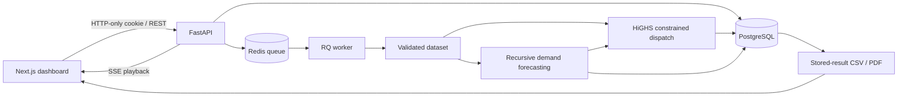
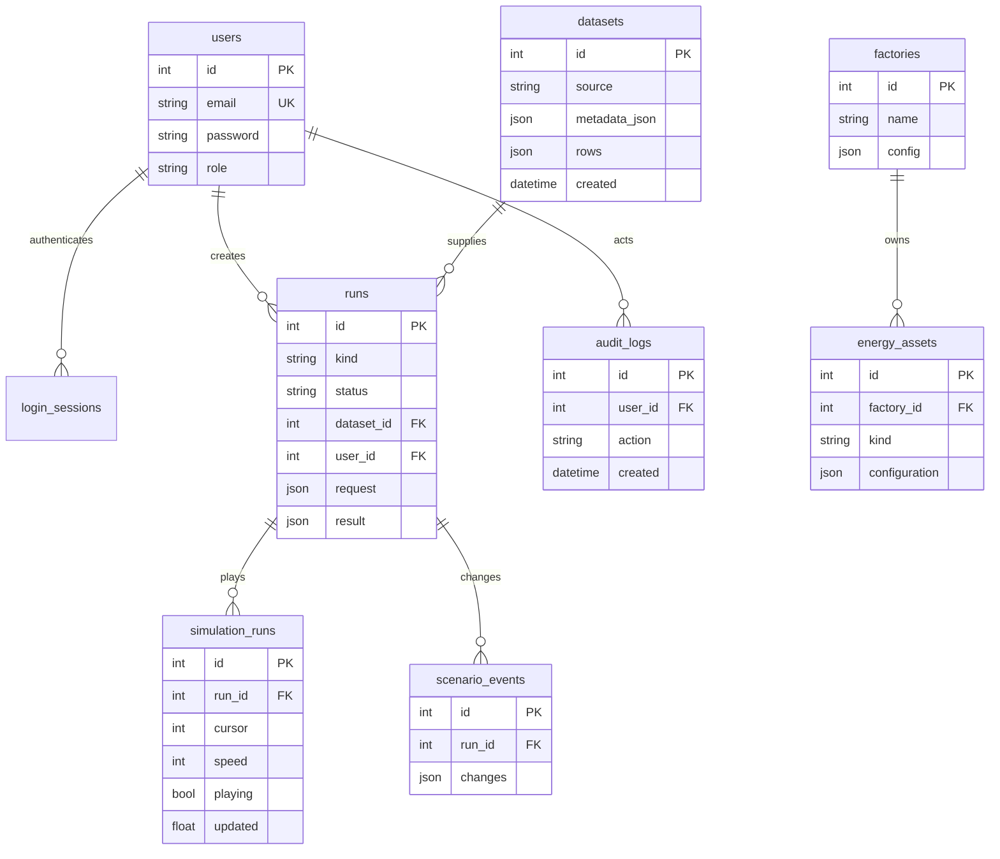

# Architecture

The API is authoritative for simulation playback. The browser never advances SOC or computes savings. A playback record stores its run, cursor, speed, playing flag and wall-clock update time. Server requests materialize elapsed time into the cursor; reopening a stream resumes the persisted state. Reset and seek affect playback, not the immutable dispatch result.

RQ workers read the persisted request and dataset, perform calculations, and write status/results. The development-only `JOB_MODE=inline` executes the same function without Redis. Failures are persisted and surfaced to the UI. Jobs have a 600-second timeout; each HiGHS solve has a 60-second limit and rejects unsuccessful solves.

## Physical schema

Consumption readings, solar readings and tariff plans are stored together as immutable, aligned dataset JSON rows. Asset configurations are factory snapshots. Forecast runs, optimization runs and scenario comparisons share the indexed `runs` table, discriminated by `kind`. This compact schema deliberately uses fewer physical tables than the conceptual brief while preserving those data types. It is suited to local scenarios, not high-volume meter telemetry; time-series normalization/partitioning is a future scale-out migration.

Indexes cover run kind, creation time and scenario-run linkage. User email is unique; roles have a database check constraint. Foreign keys link runs, datasets, users and playback. Alembic revision `001` creates the schema; application startup does not silently create tables.

All signed-in users share a single local workspace. Viewers can inspect and export all runs; analysts can import, configure and calculate; only admins can create users or read audit logs. This is intentional shared-workspace authorization, not tenant isolation.
